# Code Architecture (`v0.7.1`)

`autocalc` is a TypeScript-on-Bun CLI and MCP server (`package.json` `0.7.1`) that compiles quote specs into canonical cards, encodes each card inside the real Huawei Cloud calculator SPA via Playwright ([ADR-0001](adr/0001-page-as-encoder.md)), and returns a share link **only after the fail-closed publish gate passes** (`stored == rated == Edit`, [ADR-0003](adr/0003-fail-closed-publish-gate.md)).

For the conceptual layer rationale see [Explanation: Architecture](explanation/architecture.md); this page is the **code map** linking runtime stages to exact files, concurrency bounds, and documentation ownership.

---

## End-to-End Flow (`draft → plan → apply → gate → publish`)

```mermaid
flowchart LR
  IN["CLI / MCP<br/>src/cli.ts · src/mcp.ts · src/core/registry.ts"] --> ACT["Shared Dispatch<br/>src/core/actions.ts"]
  ACT --> QF["Quote File Loader<br/>src/core/quote-file.ts<br/>+ quote-file-helpers.ts"]
  QF -->|version 1 YAML| COMP["Offline Compiler<br/>src/core/compiler/index.ts<br/>normalizer/{aliases,shared,*.ts}"]
  COMP --> VAL["Schema & Range Validation<br/>src/core/schema-model.ts<br/>src/schema/files/*.yaml"]
  QF --> VAL
  VAL --> PLAN["Draft & Rank (Offline / Cached API)<br/>src/core/workflow.ts · src/core/quote/<br/>src/providers/huawei.ts · src/core/catalog.ts"]
  ACT --> PLAN
  PLAN -->|plan lock + shards| PUB["Orchestrator<br/>src/core/publish.ts"]
  PUB -->|form + encodeWorkers <= 3| ENC["Page Encoder (Warm Pool)<br/>src/core/page/encode.ts<br/>src/core/browser.ts"]
  ENC --> GATE["Fail-Closed Publish Gate<br/>src/core/gate.ts"]
  GATE -->|RATING_WORKERS = 4| RATE["Rerate via API<br/>src/core/cards.ts"]
  GATE -->|editWorkers <= 3| EDIT["Parallel Edit Check<br/>src/core/page/edit.ts<br/>src/core/page/store.ts"]
  RATE --> DEC{"stored == rated == Edit?"}
  EDIT --> DEC
  DEC -->|Yes| LINK["Verified Share Link + lock.yaml"]
  DEC -->|No| DEL["Delete Remote List · throw GATE_FAILED"]
```



---

## Stage Responsibilities & Layer Rules

Architectural boundaries are enforced automatically by `bun run check:boundaries` (`scripts/check-boundaries.ts`):

- **Interfaces (`src/cli.ts`, `src/mcp.ts`)**: Parse CLI flags or MCP stdio JSON schemas and call `src/core/registry.ts` / `src/core/actions.ts`.
- **Core (`src/core/**`)**: Never imports `commander` or `@modelcontextprotocol/sdk`, never writes directly to `stdout` (`console.log` / `process.stdout.write` forbidden), and maintains **zero circular relative imports** (`findRelativeImportCycles(["src"])`).
- **Compiler (`src/core/compiler/`)**: Pure TypeScript/YAML translation (`units.ts` → `expander.ts` → `normalizer/{aliases,shared,compute-storage,database-middleware,network-security-paas,index}.ts` → `ir.ts` → `wire.ts` / `anti-split.ts` / `lockfile.ts`) with memoized catalog reads in `src/core/catalog.ts` and `src/core/schema-model.ts`.
- **Quoting & Provider (`src/core/quote/`, `src/providers/huawei.ts`)**: Provider-neutral `Draft` / `Candidate` / `rank()` / `RunRecord` (`AUTOCALC_DATA`, default `~/.local/share/autocalc`) and exact decimal arithmetic (`src/core/quote/decimal.ts`).
- **Browser & Gate (`src/core/browser.ts`, `src/core/page/`, `src/core/gate.ts`)**: Real SPA form driving and independent 3-way verification (`stored == rated == Edit`).

---

## Concurrency & State Model ([ADR-0010](adr/0010-concurrency-by-state.md), [ADR-0020](adr/0020-bounded-browser-context-pool-and-staggered-edit-check.md))

| Component | File | Concurrency / State | Why |
|---|---|---|---|
| Schema & Catalog Reads | `src/core/schema-model.ts`, `src/core/catalog.ts` | Per-process RAM memoization (`clearServiceSchemaCache` for tests) | Eliminates repeated YAML/JSON + Zod parsing per card |
| Page Encoding | `src/core/publish.ts` (`encodeWorkers`), `src/core/page/encode.ts` | `AUTOCALC_ENCODE_WORKERS` (`1..16`, default `<= 3` by CPU/RAM); `reuse: attempt === 0` | Bounded parallel anonymous contexts + warm page reuse (`MAX_SLOT_USES = 25`, `MAX_IDLE_SLOTS = 8` in `src/core/browser.ts`) with storage/cookie/listener scrub |
| Rating Check (`rerate`) | `src/core/gate.ts` (`RATING_WORKERS`) | Fixed `4` concurrent stateless HTTP POSTs | Fast API verification without session contention |
| Edit Check (`verify`) | `src/core/page/edit.ts` (`editWorkers`), `src/core/page/store.ts` | `AUTOCALC_EDIT_WORKERS` (`1..16`, default `<= 3` by CPU/RAM); 1.5 s remote stagger; `tagCard` `_cartId` direct lookup | Balanced contiguous slices merged by card `index`; fail-closed parity with sequential verification |
| Persistent Profile (`save`/`lists`) | `src/core/browser.ts` (`withProfile`), `src/core/profile-lease.ts` | Serialized FIFO queue + file lease | Protects single logged-in Huawei Cloud browser profile from cookie/state corruption |

---

## Where to Touch for Common Changes

| Goal | Primary Files | Verification |
|---|---|---|
| Add or fix a service card builder / recipe | `src/core/services/<svc>.ts` or `forms.ts`, `src/core/services/publication.ts`, `src/schema/files/<svc>.yaml` | `bun run test:offline`, `bun run docs:generate`, `bun run compat <svc>` |
| Change `version: "1"` unit / alias / option mapping | `src/core/compiler/normalizer/{aliases,compute-storage,database-middleware,network-security-paas}.ts` | `bun test tests/unit/compiler/` |
| Adjust planning, locking, or multi-shard orchestration | `src/core/quote-file.ts`, `src/core/quote-file-helpers.ts` | `bun test tests/unit/quote-file.test.ts tests/integration/` |
| Modify fail-closed publish gate or Edit check | `src/core/gate.ts`, `src/core/page/edit.ts`, `src/core/page/store.ts` | `bun test tests/unit/page-edit.test.ts tests/integration/publish-failure-matrix.test.ts` |
| Add a CLI option or MCP tool | `src/core/schemas.ts`, `src/core/registry.ts`, `src/core/actions.ts`, `src/core/views.ts`, `docs/reference/cli.md` | `bun run test:offline` (`docs-contract.test.ts`, `interfaces.test.ts`, `mcp-stdio.test.ts`) |
| Profile or compare performance regressions | `scripts/bench.ts`, `scripts/bench-report.ts` | `bun run bench && bun run bench:report` (run isolated, no competing load) |

---

## Benchmarks & Reproducible Reporting

1. **Offline benchmark suite** (local loopback HTTP/SPA + real headless Chromium):
   ```bash
   bun run bench
   bun run bench:report   # generates self-contained bench/dashboard.html
   ```
   Useful flags: `--scenarios 1-resource,100-resources`, `--warmup N`, `--repetitions N`, `--baseline` (overwrites `bench/baseline.json`).
2. **Live benchmark mode** (requires active `autocalc login` session + network; deletes temporary `[autocalc-bench]` lists on completion):
   ```bash
   bun run bench -- --live
   bun run bench:report
   ```
3. **Commit policy**: Heavy per-run JSONs live in gitignored `bench/results/`; only small curated baselines (`bench/baseline.json`, `bench/baseline-live.json`) and generated `bench/dashboard.html` are tracked.

---

## Documentation Ownership Map

| Document | Role | Source of Truth For |
|---|---|---|
| `docs/architecture.md` (this file) | Code entrypoint | Pipeline flow, module boundaries, concurrency limits, benchmark commands |
| `docs/status.md` | Release snapshot | Current version (`0.7.1`), schema/service counts, latest measured benchmark deltas |
| `docs/roadmap.md` | Single backlog | Delivered OpenSpec changes and all open items (no GitHub issues used) |
| `docs/handoff.md` | Session pointer | Brief resumption note pointing to status, roadmap, and architecture |
| `openspec/` & `docs/adr/` | Specs & decisions | Formal change proposals (`openspec/changes/`) and architectural ADRs |
