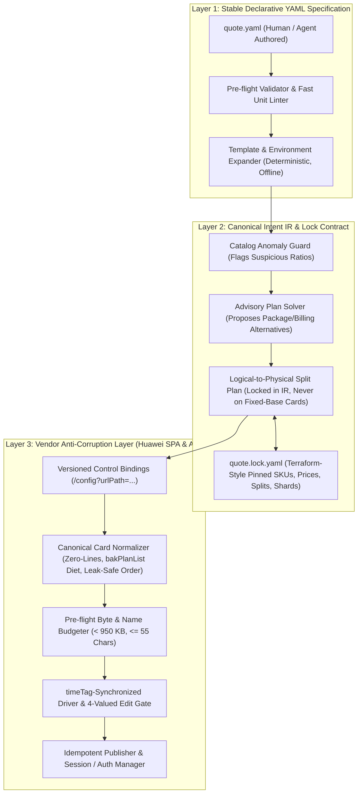

# Next-Generation `autocalc` YAML Architecture

> [!IMPORTANT]
> This design decouples **what the user/agent wants to quote** (Layer 1: Stable YAML Specification) and **what the resolved quote means economically** (Layer 2: Canonical Intent IR & Lock Contract) from **how Huawei Cloud's calculator SPA and API behave on a given frontend version** (Layer 3: Unstable Vendor Anti-Corruption Layer).

---

## 0. Glossary of Terms

To keep everyone on the same page across users, agents, and developers:

- **Quote (`quote.yaml`)**: The human/agent-authored declaration of cloud infrastructure needed (e.g., "6 Kubernetes workers, 1 Redis HA, 100 TB OBS").
- **Quote List / List**: A distinct saved shopping cart on the Huawei Cloud calculator portal (e.g., `Acme - Prod - Compute`).
- **Share Link**: The public, read-only URL generated by Huawei Cloud when a list is shared (`https://calculator.huaweicloud.com/calculator/#/share?token=...`). A single quote may correspond to one or more share links if sharded across environments or payload limits.
- **Card**: A single item inside a Huawei Cloud quote list (e.g., an ECS instance, an RDS instance, or an OBS bucket configuration).
- **Logical Resource**: A resource defined by the user in `quote.yaml` (e.g., 50,000 KMS requests/mo).
- **Physical Card**: The actual card submitted to Huawei Cloud's portal (which may split a logical resource if vendor UI controls clamp at lower limits).
- **Lockfile (`quote.lock.yaml`)**: A Terraform-inspired pinned snapshot generated by `autocalc plan`. Records exact catalog SKUs, verified prices, physical card mappings, and share links so subsequent runs are 100% deterministic and auditable.
- **Horizon**: The financial evaluation window (e.g., 1 month, 1 year).

---

## 1. Horror-Story & Failure-Mode Matrix (GitHub Issues #1, #2, #4, #5, #6)

Every failure mode and one-off recovery script (`complete_yearly_lists.py`, `pool_ppu_cards.py`, `obs_packages_publish.py`, `canonicalize_obs_cards.py`, `reorder_obs_cards.py`, `annual_publish.py`) from real-world 300+-card enterprise quotes traces back to **vendor UI/API quirks leaking into user specifications or card construction**:

| # | Horror Story / Failure Mode | Source | Root Cause in Vendor / Current Stack | Target Layer |
| :- | :--- | :--- | :--- | :--- |
| **1** | **OBS pay-per-use storage resets capacity to `0` on Edit** ("No data matched", drops storage line). | [GH #1](https://github.com/araujoviana/autocalc/issues/1), [GH #2](https://github.com/araujoviana/autocalc/issues/2), [`edit-verification.md`](docs/research/edit-verification.md) | Framework `11.4.201` (`changeNextStatus` L45928) clears pending `rewriteStatus["calculator_multiAZ_radio"]` when cascaded source (`storageType_switch`) is momentarily empty on first tick. | **Layer 3** (Versioned Known-Defect Quarantine + Package Preference) |
| **2** | **Missing zero-usage template lines inject phantom charges on Edit** (+USD 145.26 on OBS cards missing `download_*_external` because portal substitutes 1,076 GB default). | [GH #2](https://github.com/araujoviana/autocalc/issues/2), [GH #5](https://github.com/araujoviana/autocalc/issues/5) | Portal `template-render` substitutes default usage when expected `productAllInfos` lines are absent. Conversely, naive builders include *all* zero lines + full `bakPlanList`, bloating payloads past 1 MiB. | **Layer 3** (Canonical Line-Set Normalizer & `bakPlanList` Stripper) |
| **3** | **Editing cards in sequence leaks values across cards** (`valueWatcher` not cleared in `setValue` L46080; OBS `download*` and capacity leak from card $i$ to card $i+1$). | [GH #2](https://github.com/araujoviana/autocalc/issues/2), [GH #5](https://github.com/araujoviana/autocalc/issues/5), [`edit-verification.md`](docs/research/edit-verification.md) | Shared Pinia/Vue component state when editing multiple cards in one context; requires fresh browser context per card in verification AND deterministic leak-safe card ordering (`capacity-free → zero-download → non-zero-download`) in published lists. | **Layer 3** (List Card Sequencer & Fresh-Context Edit Verifier) |
| **4** | **Silent UI stepper clamping & missing quantity controls**: `DEW kms_api` > 9,999 → 9,999; `DEW secrets` > 99 → 99; `OBS requests` > 9,999; `OBS storage/traffic` > 102,400 GB. **ELB, CCI, APIG, and ONDEMAND OBS lack `global_QUANTITY_Stepper_0`** (quantity > 1 collapses to 1 on Edit). | [GH #5](https://github.com/araujoviana/autocalc/issues/5), [GH #6](https://github.com/araujoviana/autocalc/issues/6), [`card-rules.md`](docs/explanation/huawei/card-rules.md) | User intents express total workload (e.g., 50,000 KMS calls, 3 ELBs, 250 TB OBS), while a single vendor UI card has arbitrary widget caps. | **Layer 2 → Layer 3** (Logical-to-Physical Card Splitter: 1 Logical Resource $\to N$ Physical Cards) |
| **5** | **Tiered pricing distortion under card splitting**: splitting or pooling OBS outbound/read traffic across cards changes the total price by tens/hundreds of USD because each card starts at Tier 1 (0–10 TB). | [GH #6 §4](https://github.com/araujoviana/autocalc/issues/6) | Vendor rates tiered usage per card rather than per list. Arbitrary card splitting alters marginal tier brackets. | **Layer 2** (Tier-Aware Split Solver & Price Invariant Check) |
| **6** | **Multi-AZ & unit/shape traps**: OBS `unit` defaults to TB, turning `95043` GB (USD 3,516) into `95043` TB (USD 3.6M). Requesting `size_3az` with measure 9/10 fails (`CBC.6050`) instead of measure 17. Annual multi-AZ OBS expects `monthly GB` + `UNSET_Stepper_2 = months` and `productNum = 720 × months`. | [GH #1](https://github.com/araujoviana/autocalc/issues/1), [GH #4](https://github.com/araujoviana/autocalc/issues/4), [GH #6 §5](https://github.com/araujoviana/autocalc/issues/6) | Leaky unitless numbers and decoupled display/billing factors in builder inputs. | **Layer 1** (Mandatory Explicit Units `95043 GB`, Semantic `availability: multi-az`) + **Layer 3** (Measure/Factor Compiler) |
| **7** | **1-Year horizon & hybrid billing gaps**: yearly quotes need PPU-only items (DEW, LTS, non-Standard OBS, EIP reservation) scaled to 1 year (`8760h`, `365d`, `12mo`, or `12×` monthly volume), plus automatic comparison of `yearly package` vs `12 × monthly` vs `prepaid data packs`. | [GH #5 §4](https://github.com/araujoviana/autocalc/issues/5), [GH #6 §7–8](https://github.com/araujoviana/autocalc/issues/6) | Billing horizon ("quote this architecture for 1 year") is conflated with per-card `chargeMode` (`PERIOD` vs `ONDEMAND` vs `RI`). | **Layer 1** (Quote-level `horizon: 1y` & `billing_policy`) + **Layer 2** (Horizon & Advisory Plan Suggestions) |
| **8** | **Catalog & portal pricing anomalies**: DCS Redis HA yearly SKU rates at `14.7×` monthly (`redis.ha.xu1.large.r2.8` = USD 2,912.34/yr vs USD 198.56/mo). DMS Kafka yearly card re-prices on Edit (USD 7,475.40 vs saved USD 5,717.40). Redis `calculator_redis_bandwidth_switch` is PPU-only and breaks yearly encode unless stripped. | [GH #4 §2](https://github.com/araujoviana/autocalc/issues/4), [GH #5 §4](https://github.com/araujoviana/autocalc/issues/5), [GH #6 §9](https://github.com/araujoviana/autocalc/issues/6) | Corrupt upstream catalog ratios and mode-specific vestigial controls. | **Layer 2** (Catalog Sanity Guard: flags/blocks `yearly > 11.5 × monthly`) + **Layer 3** (Mode Control Sanitizer & Known-Defect Table) |
| **9** | **Transport, list-name & idempotency limits**: HTTP 413 around ~1 MiB (~250 cards) discovered only at publish time; list names $\ge 60$ chars fail with opaque `UPSTREAM`; intermittent `MUTATION_UNKNOWN` on save creates duplicate lists on naive retry; in-place `share/update` lacked rollback. | [GH #4 §1](https://github.com/araujoviana/autocalc/issues/4), [GH #5 §1, §5](https://github.com/araujoviana/autocalc/issues/5), [GH #6 §1, §11](https://github.com/araujoviana/autocalc/issues/6) | Unchecked wire constraints and non-idempotent remote mutations. | **Layer 3** (Pre-flight Byte Budgeter, Auto-Sharder, Name Validator, Idempotent Reconciler & Blue/Green Snapshot Rollback) |
| **10** | **False-negative / false-positive Edit gate**: 1.5s empirical quiet window fails slow loads as `drift` (deleting valid 30-card lists on a 1% page load flake $\to 26\%$ list failure rate) while missing late emissions, extra leaked keys, or equal-total/different-SKU swaps. | [GH #5 §3, §10](https://github.com/araujoviana/autocalc/issues/5), [`edit-verification.md`](docs/research/edit-verification.md) | Conflating `load_failed` (transient browser/network fault) with `drift` (deterministic mismatch), and polling pre-Save state instead of inspecting the post-Save artifact tied to `timeTag`. | **Layer 3** (3-Valued Verdict Engine: `ok` \| `drift` \| `load_failed` \| `known_defect` + `timeTag` Barrier + Post-Save Artifact Audit) |

### Key User Realities & Constraints
- **Zero Watermarking**: The name `autocalc` MUST NEVER be written anywhere in user-facing card titles, list names, or exported spreadsheets. All titles belong 100% to the user.
- **Empirical Stepper Limits**: Vendor field limits (e.g. 99, 9999, 102400) cannot be guessed — they must be verified empirically or extracted directly from UI schemas.
- **Predictability Over "Smart" Black-Box Optimization**: Never magically alter billing modes or rewrite configurations behind the user's back. What is written in `quote.yaml` is what gets quoted. If a cheaper alternative exists (e.g., yearly package vs 12x PPU), `autocalc plan` proposes it as a documented advisory warning/diff, never a silent mutation.
- **Inherent Service Costs & Anti-Splitting Rule**: Resources with baseline fixed costs (like CCE cluster management fees, fixed node fees, or ELB hourly baselines) must **NEVER** be split across multiple cards, because splitting would duplicate base costs. Splitting only applies to purely variable metric lines (such as KMS API requests) when strictly bounded by vendor widget limits.
- **Primary Region Focus**: São Paulo (`sa-brazil-1`) is the core MVP region. Santiago (`la-south-2`), Singapore (`ap-southeast-1`), and Hong Kong (`ap-southeast-3`) are secondary.

---

## 2. Three-Layer Decoupled Architecture



---

### Layer 1: Stable Declarative YAML Specification

1. **Zero Vendor UI Leakage**: No `dataInfo_43_`, `calc_29_`, `UNSET_Stepper_0`, `size_3az`, or `measureId: 17`. Stable cloud domain vocabulary (`availability: multi-az`, `storage_class: standard`).
2. **No Fake Web Domains**: Simple, clean schema versioning (`version: "1"`). No fictional URLs like `apiVersion: autocalc.io/v2`.
3. **Mandatory Dimensional Units**: Capacities, bandwidths, and request rates require units (`95043 GB`, `10 Mbit/s`, `730 h`, `50000 k/mo`). Prevents catastrophic 1,000x unit conversions (e.g. GB interpreted as TB).
4. **DRY Machine Templates**: Reusable specs (e.g. `k8s_worker`) prevent repeating vCPU/RAM/disk across dozens of instances.
5. **Instant Offline Linting (`autocalc lint`)**: Executes in <50ms without network. Catches invalid units, missing regions, and syntax errors immediately.

#### Concrete `quote.yaml` Draft

```yaml
version: "1"

metadata:
  id: qitech-gcp-migration
  customer: Acme FinTech
  title_prefix: "Acme - GCP to HWC"   # List names generated: "Acme - GCP to HWC - DMZ", etc. Guaranteed <= 55 chars.
  currency: USD                     # Always USD for MVP.

horizon:
  duration: 1y                        # Financial evaluation window: 1m | 1y (future: N months)
  billing_policy: as-specified        # as-specified (strict) | recommend-annual (advisory warnings only)

defaults:
  provider: huawei
  region: sa-brazil-1                 # Primary MVP region (São Paulo)
  availability: multi-az

# Templates: Reusable machine archetypes so you don't repeat specs 10 times
templates:
  k8s_worker:
    service: ecs
    needs:
      vcpus: 8
      memory: 32 GiB
    options:
      os: ubuntu-22.04
      system_disk: { type: ultra-high-io, size: 100 GiB }
      data_disks:
        - { type: high-io, size: 500 GiB }

environments:
  dmz:
    region: sa-brazil-1
  prod:
    region: sa-brazil-1

resources:
  # Using a template
  - id: dmz-workers
    environment: dmz
    use: k8s_worker
    quantity: 6
    billing: yearly                   # Pinned strictly to yearly; no silent switches

  - id: prod-redis-ha
    environment: prod
    service: redis
    quantity: 2
    needs:
      engine: redis-6.0
      topology: master-standby
      memory: 8 GiB
    billing: monthly                  # Preserves explicit billing; planner warns if yearly SKU is anomalous

  - id: prod-archive-obs
    environment: prod
    service: obs
    billing: ondemand
    options:
      storage_class: standard
      availability: multi-az          # Layer 3 compiles to 3AZ factor + measure 17
      capacity: 95043 GB              # Explicit unit required; never defaults to TB!
      egress_traffic: 150 TB/mo

  - id: prod-kms
    environment: prod
    service: dew
    billing: ondemand
    options:
      keys: 20
      kms_api_requests: 50000 k/mo    # Variable metric: exceeds 9,999 UI clamp -> plan explicitly splits into cards
```

---

### Layer 2: Canonical Intent IR & Lock Contract (`quote.lock.yaml`)

Inspired directly by `terraform.lock.hcl`, the lockfile records the exact resolved state of the quote:

1. **Advisory Warnings, Not Silent Rewrites**:
   - If the user specifies `billing: ondemand` for 100 TB OBS, `autocalc plan` warns that an annual Storage Package saves $X. It **never** silently replaces it unless the user updates `quote.yaml`.
   - If a catalog anomaly is detected (e.g. DCS Redis HA yearly at 14.7x monthly), `autocalc plan` halts or emits a prominent warning banner with the exact numbers.
2. **Explicit Card Splitting at Lock Time**:
   - Splitting occurs in Layer 2 and is committed to `quote.lock.yaml`. Layer 3 never invents split cards dynamically at runtime.
   - **Strict Cost Invariant**: Fixed-base resources (clusters, base VMs, ELBs) are never split. Only unbounded variable metrics (e.g. KMS API call counts) are partitioned, and the sum of prices across partitions must equal the total mathematical workload price.
3. **Deterministic Structure of `quote.lock.yaml`**:
   - Pinned catalog SKU codes, measure IDs, and unit prices.
   - Pinned partition counts (e.g., `prod-kms` $\to$ 5 physical cards of 9,999 calls + 1 card of 5 calls).
   - Expected cent-exact subtotal per card, per list, and overall quote total.
   - Target share link URLs mapped per list/environment.

---

### Layer 3: Unstable Vendor Adapter & Session Manager (Huawei Cloud)

1. **Control Bindings Extracted from Portal Config**:
   - Reads control definitions, dependencies (`cascadedSource.inputs`), and valid ranges directly from `/config?urlPath=<service>`.
2. **Pre-Publish Canonicalizer**:
   - Automatically injects mandatory zero-usage lines (preventing phantom charges on OBS Edit, GH #2).
   - Strips foreign usage entries from `bakPlanList` (shrinking payloads by 60–80%, avoiding HTTP 413, GH #6).
   - Sequences cards deterministically (`capacity-free → zero-download → non-zero-download`) to eliminate Vue/Pinia state leaks between cards (GH #5).
   - Validates that list names stay $\le 55$ characters.
3. **`timeTag`-Synchronized Verification Gate**:
   - Uses `timeTag` barrier instead of empirical sleep timers.
   - Executes verification in an isolated browser context per card.
   - Distinguishes 4 outcomes: `ok`, `drift` (actual catalog/DOM change), `load_failed` (network timeout), and `known_defect` (quarantined upstream bugs).
4. **Session & Auth Management**:
   - Manages anonymous sessions vs. authenticated accounts cleanly.
   - Supports local encrypted token cache with clear CLI status (`autocalc login status`).
   - Idempotent list-lookup reconciliation: checks remote lists by hash/title before publishing to prevent duplicate lists on transient timeouts.

---

## 3. Provider Documentation & Compatibility Matrix

To avoid combinatorial explosion across all configurations while remaining readable for users and developers:

1. **Service Matrix Docs (MkDocs / Static Markdown)**:
   - Generate automated compatibility reference tables under `docs/reference/providers/huawei/`.
   - Table columns: `Service`, `Supported in sa-brazil-1`, `Single-AZ`, `Multi-AZ`, `Billing Modes (PPU / Monthly / Yearly)`, `Max Stepper Clamp`, `Known Caveats`.
   - Primary focus is `sa-brazil-1` (São Paulo MVP), followed by Santiago, Singapore, and Hong Kong.
2. **Automated Schema Verifier**:
   - A CI job periodically checks `/config?urlPath=<service>` against the matrix, flagging newly introduced portal fields or changed stepper limits before they cause production failures.

---

## 4. Design Decisions Status

1. **Logical-to-Physical Card Splitting**: **Resolved**: Splitting is computed during `autocalc plan` and materialized explicitly inside `quote.lock.yaml`. Layer 3 only receives already-partitioned physical cards. Base-cost resources are strictly protected from splitting.
2. **Multi-List Sharding & Account Scope**: **Resolved**: `quote.lock.yaml` owns a list of share links (`lists: [{ name, url, cards: [...] }]`). Lists are partitioned cleanly by environment/billing bucket or pre-flight byte limit (<950 KB). Account ownership is scoped to the active local user profile.
3. **Handling `known_defect` Cards**: **Resolved**: The system never quietly accepts defects as invisible normal behavior. If a known defect exists (e.g. OBS PPU storage capacity drop on Edit), `autocalc plan` displays an actionable warning and requires an explicit opt-in/waiver (`allow_known_portal_defects: [...]`) or recommends an Edit-safe alternative (e.g. Storage Package).
4. **Schema Binding Extraction**: **Recommendation**: Hybrid model — static parsing of the vendor `/config?urlPath=<service>` JSON payload for fast offline schema updates and dependency DAGs, with headless Chromium used purely as a verification gate.
