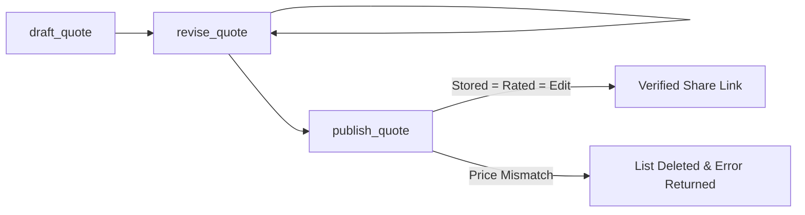

# Agent & MCP-First Quotation Workflow

This guide details the recommended workflow for AI agents (and automated tools) using AutoCalc's Model Context Protocol (MCP) server.

Following this workflow ensures that quotations remain reproducible, inspectable, and fail-closed against pricing drift ([ADR-0003](../adr/0003-fail-closed-publish-gate.md), [ADR-0007](../adr/0007-workflow-surface-and-one-registry.md)).

---

## Core Principles

1. **The Share Link is the Deliverable**: Unverified price estimates or screenshots are not substitutes for a verified Huawei Cloud Pricing Calculator share link ([ADR-0002](../adr/0002-share-link-is-the-deliverable.md)).
2. **Fail-Closed Verification**: Every published link must pass the three-way check:
   $$\text{Stored Price} = \text{Rated Catalog Price} = \text{Interactive Cart Edit Price}$$
3. **No Secret Workarounds**: Agents must not write ad-hoc browser automation scripts to bypass verification failures. Discovered bugs or missing options must be recorded as research notes or proposed as OpenSpec enhancements.

---

## 1. Discovery Phase (No Login Required)

Before authoring a quote, discover available services, options, and regions:

### List Supported Services & Schema Coverage
- Read the MCP resource `autocalc://schema/index` or call `supported_services` to check if the target service is supported (`VERIFIED` vs. `ACCEPTED_DEFAULT_ONLY`).
- Call `describe_service` with the service code (e.g., `ecs`, `obs`, `rds`) to inspect available options, required fields, and schema limits.

### Search Catalog Flavors & SKUs
- Call `regions` to resolve region codes (e.g., `sa-brazil-1` for São Paulo, `la-south-2` for Santiago).
- Call `search_catalog` to query flavors, vCPU/RAM bounds, and list prices:
  ```json
  {
    "service": "ecs",
    "region": "sa-brazil-1",
    "query": "linux",
    "vcpus": 4,
    "memory_gb": 8,
    "billing": "monthly"
  }
  ```

---

## 2. Quotation Lifecycle (`draft` → `revise` → `publish`)

Always execute quotations through the 3-step state machine defined in ADR-0007:



### Step 1: `draft_quote`
Initialize the quote with the customer name, title, and initial resource cards:
```json
{
  "customer": "Example Corp",
  "name": "[autocalc] web-cluster",
  "region": "sa-brazil-1",
  "billing": "monthly",
  "cards": [
    {
      "id": "web-nodes",
      "service": "ecs",
      "quantity": 3,
      "needs": { "vcpus": 4, "memory_gb": 8 },
      "options": { "image": "Ubuntu 22.04 server 64bit" }
    }
  ]
}
```
The response returns a unique `draft_id`, candidate SKU selections, and any schema warnings.

### Step 2: `revise_quote`
Adjust configurations, add storage or networking cards, or override specific SKU codes:
```json
{
  "draft_id": "draft_018f...",
  "actions": [
    {
      "action": "add_card",
      "card": {
        "id": "data-volume",
        "service": "evs",
        "quantity": 3,
        "options": { "type": "SSD", "size_gb": 200 }
      }
    }
  ]
}
```
Always check the returned `warnings` field.

### Step 3: `publish_quote`
Publish the draft to the live calculator:
```json
{
  "draft_id": "draft_018f..."
}
```
The publish gate drives headless Chromium in the background:
1. Encodes all cards onto the real form.
2. Saves the quote list on the user's account.
3. Reloads the saved list via share URL and inspects stored amounts.
4. Opens **Edit** on each card and verifies that the form re-evaluates to the exact same price.
5. If verified, returns the public share link URL.
6. If any price mismatches, deletes the temporary list and returns a descriptive error code.

---

## 3. Handling Warnings & Anomalies

AutoCalc surfaces actionable warnings in tool outputs:

- **Catalog Pricing Anomalies** (`RES-006`): Warns when upstream yearly prices exceed 11.5x monthly. Present this anomaly to the user so they can decide whether to choose monthly or yearly.
- **Circuit Breaker Skips** (`RES-003`, `RES-007`): Known vendor defects (e.g., OBS pay-per-use capacity drop on edit, Kafka yearly duration drop) are bypassed only when stored and rated prices strictly agree. These return `RATING_VERIFIED_EDIT_SKIPPED` with an explanatory note.
- **Unmapped Options**: If an option is specified that the service schema does not map, the tool flags an unmapped option warning.

---

## 4. Role of Research Scripts

During development or debugging, scripts in `scripts/` (e.g. `pull-corpus.ts`, `template-audit.ts`) can be used to investigate vendor behaviors.

**Rules for AI Agents:**
- **Never substitute a custom script for `publish_quote`**: Running Playwright directly to generate a share link without the publish gate violates ADR-0003 and risks handing the user a corrupt link.
- **Report Gaps**: If a service option or configuration cannot be expressed via declarative quote or MCP tools, document it as a research gap in `docs/research/index.md` and propose a change in `openspec/changes/`.
