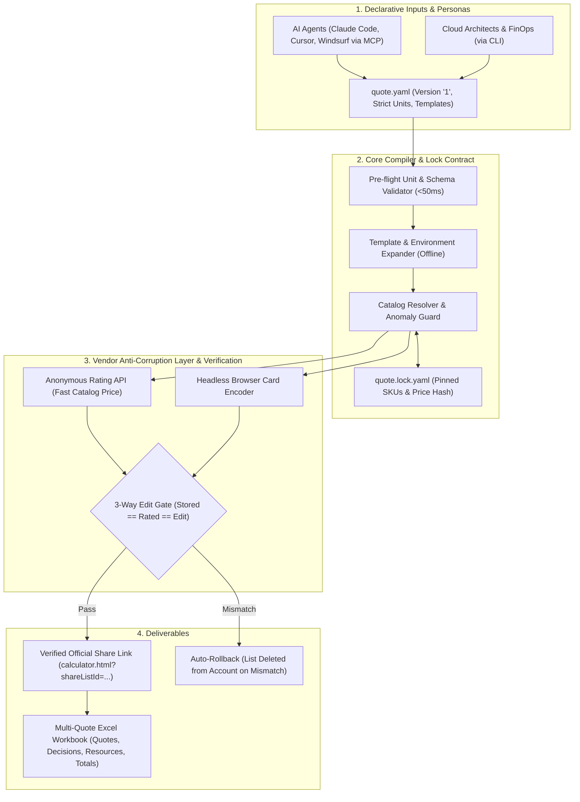

# autocalc

autocalc lets an AI agent, or a person at a terminal, turn "price this for customer Y" into a
**verified share link** on a cloud provider's own pricing calculator. Huawei Cloud is supported
today, and AWS is planned as the second provider.

> **Experimental.** autocalc drives the public calculator page and breaks when Huawei changes it. Check every link before you send it.

The link is the deliverable. It opens without login, shows list prices in USD, and has to
re-price to the same amount when someone clicks **Edit**. A link that doesn't is a fatal bug,
not a cosmetic one ([ADR-0002](adr/0002-share-link-is-the-deliverable.md)).

## Who is autocalc for?

autocalc is built around two first-class personas:

1. **AI Agents (Claude Code, Cursor, Windsurf via MCP)**:
   Automated architecture pricing, interactive requirement resolution, and verified link delivery directly within the AI programming loop without manual browser clicking.
2. **Cloud Architects & FinOps Engineers (via CLI)**:
   Rapid catalog search, declarative versioned YAML quotes (`quote.yaml`), offline validation (<50ms linting), and multi-quote Excel workbook export for enterprise bids.

## Why autocalc?

In enterprise procurement, formal cloud RFPs, and partner deal registration programs (such as Huawei Cloud partner portal or distributor deal registration), pricing cannot simply be an unverified text snippet, markdown estimate, or third-party spreadsheet. Cloud provider account executives, solution architects, and procurement desks require an authentic, reproducible share link on the cloud provider's official calculator portal (`calculator.html?shareListId=...`).

This official link proves the exact bill of materials (BOM), regional SKU availability, and official list pricing, allowing vendor sales teams to apply deal discount curves, generate partner approval codes, and convert the quote directly into an official order or customer contract.

| Capability / Workflow | Manual Calculator Web UI | Generic Estimators (Infracost, etc.) | autocalc |
| :--- | :--- | :--- | :--- |
| **Official Provider Share Link** | Yes (slow, repetitive manual selection across dozens of dropdowns per card) | No (emits markdown tables or proprietary UI dashboards only) | **Yes** (automated, official `calculator.html?shareListId=...` link in ~60s) |
| **Enterprise Procurement & Deal Reg** | Supported, but labor-intensive and prone to human configuration error | Not accepted by cloud vendor sales desks or distributor partner portals | **Accepted** (authentic provider share link ready for deal registration and RFP submission) |
| **Edit-Price Integrity Verification** | None (silent configuration drift or dropped parameters when opening link) | N/A (does not produce official calculator cards) | **3-Way Gate** (Stored = Rated = Headless Edit, or auto-deleted) |
| **Declarative Infrastructure Quotes** | None (ephemeral browser session state lost on timeout) | Terraform / HCL code only | **Declarative YAML** (`quote.yaml`, strict physical units, `quote.lock.yaml`) |
| **AI Agent Integration** | Impossible (requires interactive browser automation and CAPTCHA handling) | Webhooks or CI-only | **Native MCP Server** (Claude Code, Cursor, Windsurf via stdio) |
| **Multi-Quote Workbook Export** | One-by-one manual spreadsheet export | Git pull request diff summaries | **Automated Excel Export** (Quotes, Decisions, Resources, Totals) |

## Architecture Pipeline

## Where to go

| You want to… | Read |
|---|---|
| get a first quote and link working | [Tutorial: your first quote](tutorials/first-quote.md) |
| browse all 51 Huawei Cloud services & YAML arguments | [Huawei Cloud Service Catalog](reference/services/index.md) |
| write a declarative `version: "1"` quote or card file | [Quote files & schemas](reference/quote-files.md) |
| look up a CLI command, an error code or an endpoint | [CLI Reference](reference/cli.md) |
| do a specific job (run tests, refresh fixtures) | [How-to guides](how-to/run-tests.md) |
| understand why the calculator is hard to drive | [Explanation](explanation/architecture.md) |
| know why a decision was made | [Decisions (ADRs)](adr/index.md) |
| see what comes next and what is still open | [Roadmap](roadmap.md) |

## Where the truth lives

- **Specs** (`openspec/specs/`) say *what* autocalc must do, as testable requirements.
- **ADRs** (`docs/adr/`) say *why* a direction was chosen and which options were rejected.
- **These docs** teach and explain. When they disagree with a spec, the spec wins, and the
  disagreement is a docs bug.
