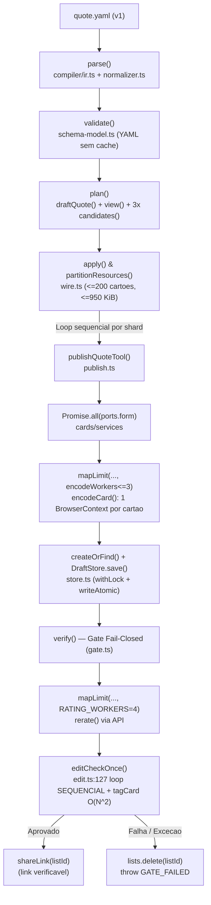

# Diagnóstico de Performance, Paralelismo, Arquitetura e Documentação

> **Escopo deste documento (Fase 1):** somente diagnóstico, instrumentação de benchmark (`offline` e `--live` mediante autorização explícita do usuário) e análise de código/documentação. Nenhum arquivo em `src/` foi modificado. Todas as afirmações estão marcadas como **`[medido]`** (saída reproduzível de `bun run bench`, `bun run bench -- --live` e `bun test tests/live/...`), **`[lido no código]`** (inspeção direta com `arquivo:linha`) ou **`[suposição]`** (extrapolação explícita quando não há medição direta para aquele caso específico, ex. 100+ recursos no modo live).

---

## 1. Caminho completo de uma cotação grande (`draft → plan → apply → gate → publish`)

Uma cotação declarativa `version: "1"` percorre sete etapas lógicas principais entre a leitura do arquivo YAML e a devolução dos links compartilhados validados pelo gate:

1. **Compilar (`parse`)** `[lido no código]`: `parse()` em `src/core/quote-file.ts:26-53` lê o arquivo YAML, compila a AST/horizonte/IR canônica via `buildCanonicalQuoteIR()` (`src/core/compiler/ir.ts:64+`) e expande recursos em cartões individuais via `normalizeResourceToCards()` (`src/core/compiler/normalizer.ts:225-346`), aplicando quebras por limite de API/SKU (ex.: DEW em blocos de 99 chaves / 9999 unidades em `normalizer.ts:231-257`, OBS em `normalizer.ts:259-333`, e recursos em serviços `SINGLE_QUANTITY` em `normalizer.ts:335-342`).
2. **Validar, rascunhar e planejar (`normalizar` / `plan`)** `[lido no código]`:
   - `validate()` (`src/core/quote-file.ts:64-97`) carrega o schema YAML de cada cartão chamando `loadService()` sem memoização (`src/core/quote-file.ts:84` -> `src/core/schema-model.ts:35-40`).
   - `plan()` (`src/core/quote-file.ts:172-260`) chama `draftQuoteTool()` (`src/core/quote-file.ts:177`), que por sua vez executa `draftQuote()` (`src/core/quote/draft.ts:11-34`) em loop sequencial `for (const req of requirements)`, disparando `provider.candidates(req)` e 5 eventos em `RunRecord.append()` por cartão (`draft.ts:20-29`, `runs.ts:10-13`).
   - Em seguida, `view()` em `src/core/workflow.ts:12-21` chama `provider.candidates(r)` novamente para requisitos sem decisão (`workflow.ts:18`), e o loop de `plan()` em `src/core/quote-file.ts:184-206` chama `unmappedOptions()` (`loadService` em `quote-file.ts:103,185`), `provider.candidates()` pela **3ª vez** (`quote-file.ts:187`) e `provider.prices()` (`quote-file.ts:206`), todos atingindo `Transport.get()` -> `CatalogCache.get()` em disco com `readFile + JSON.parse + Zod` (`src/core/transport.ts:110-141`, `src/core/cache.ts:16-26`, `src/core/catalog.ts:41-57`).
   - Ao final de `plan()`, `quote-file.ts:228-235` relê `quote.path` e reexecuta `compileQuote` para gravar `quote.lock.yaml`.
3. **Aplicar / Particionar e orquestrar shards (`apply`)** `[lido no código]`: `apply()` (`src/core/quote-file.ts:318-461`) chama `plan()` (`L319`), particiona cartões em listas de até `MAX_LIST_CARDS = 200` / `MAX_LIST_BYTES = 950 * 1024` via `partitionResources()` (`src/core/compiler/wire.ts:9-15,83+`), e para cotações multi-shard (`shards.length > 1`, `quote-file.ts:340-436`) executa um loop estritamente sequencial por shard chamando `draftQuoteTool()` (`L363`) e `publishQuoteTool()` (`L370`).
4. **Gerar formulários e codificar no SPA (`pagina`)** `[lido no código]`: dentro de `publishQuoteTool()` (`src/core/publish.ts:69-127`), todos os `builderInputs` são montados com `Promise.all(builderInputs.map(ports.form))` (`L102`), e os cartões passam por `mapLimit(draft.requirements, encodeWorkers(), ports.encode)` (`L108`), onde `encodeWorkers()` limita a concorrência padrão a no máximo `3` workers (`src/core/publish.ts:32-40`). Cada chamada a `encodeCard()` (`src/core/page/encode.ts:11-40`) abre e fecha um `BrowserContext` isolado via `withAnonymousContext({ lean: true })` (`src/core/page/encode.ts:15`, `src/core/browser.ts:47-56`), instancia `driver.open()` + `driver.run()` + `driver.capture()` (`src/core/page/driver.ts:136-143,256-274`) e localiza cartões no Store Vue via `tagCard()` (`src/core/page/store.ts:149-155`).
5. **Salvar lista (`salvar`)** `[lido no código]`: `sharePayload()` monta o payload consolidado (`src/core/cards.ts:101-109`), `DraftStore.save()` grava o rascunho em disco sob `withLock()` + `writeAtomic()` (`src/core/quote/store.ts:34-47,61-65`), e `publishChecked()` salva a lista na conta do portal via `createOrFind()` (`src/core/gate.ts:168`).
6. **Reavaliar preços via API (`rating`)** `[lido no código]`: `verify()` (`src/core/gate.ts:86-137`) busca detalhes da lista salva (`shareDetail`), valida estrutura (`validateList`, `requestIssues` `L60-67`) e reavalia os cartões em paralelo via `mapLimit(..., RATING_WORKERS, rerate)` com `RATING_WORKERS = 4` (`src/core/gate.ts:23,36-43,108`).
7. **Verificar reabertura no navegador (`edit`)** `[lido no código]`: salvo quando `AUTOCALC_DEFER_EDIT` adia explicitamente (`src/core/gate.ts:116`), `verify()` executa `deps.edit(listId)` (`L121`), que entra em `editCheckOnce()` (`src/core/page/edit.ts:114-130`). Essa função abre uma única página no Playwright (`L115-116`) e itera os cartões **um a um em sequência** (`for (const [index, card] of cards.entries()) results.push(await checkCard(...))` em `edit.ts:127`), aguardando estabilização de rede (`driver.ts:61`: `quiet = 1.5s`) e varrendo vnodes Vue com `JSON.stringify` (`store.ts:149-155`).
8. **Gate e publicação (`publicar`)** `[lido no código]`: `publishChecked()` (`src/core/gate.ts:164-189`) exige contagem exata e índices únicos (`L174`), todas as verificações aprovadas (`cardOk` e `!issues.length`, `L175`) e, em qualquer falha ou exceção (`L176-179`), deleta a lista criada (salvo `AUTOCALC_KEEP_ON_FAIL=1`, `L182-184`) antes de lançar `GATE_FAILED` (`L185-188`). Só quando passa devolve `shareLink(listId, currency)` (`L180`).

### Fluxo real em código (`quote-file.ts → publish.ts → gate.ts`)

---

## 2. Medições do Harness por Etapa (Experimento A)

Todas as medições abaixo foram produzidas pelo harness [`scripts/bench.ts`](file:///home/tideman/Projetos/python-projs/autocalc/scripts/bench.ts) executado isoladamente, em commit **`0c4b73c`**, sistema **Linux `7.3.3-1-cachyos` (`x64`)**, CPU **`12th Gen Intel(R) Core(TM) i5-12450H`** (12 threads), **`31791 MB`** de RAM e **Bun `1.4.4`**:

- **Modo `offline` (`bun run bench -- --baseline`)**: `warmup = 1`, `repetitions = 3`, SPA loopback local via `Bun.serve` + Chromium Playwright real + `CatalogCache` em disco + `DraftStore` em disco ([`bench/baseline.json`](file:///home/tideman/Projetos/python-projs/autocalc/bench/baseline.json)).
- **Modo `live` (`bun run bench -- --live --baseline`)**: `warmup = 0`, `repetitions = 1`, contra o portal e catálogo reais da Huawei Cloud com perfil autenticado e limpeza estrita pós-execução ([`bench/baseline-live.json`](file:///home/tideman/Projetos/python-projs/autocalc/bench/baseline-live.json)).

### 2.1 Tempo total e decomposição por etapa — Offline (`[medido]` em `bench/baseline.json`)

| Cenário | Rec / Cartões / Shards | Total Mediana (ms) | Total p95 (ms) | `compilar` med / p95 (%) | `normalizar` med / p95 (%) | `pagina` med / p95 (%) | `salvar` med / p95 (%) | `rating` med / p95 (%) | `edit` med / p95 (%) | `publicar` med / p95 (%) |
|---|---:|---:|---:|---:|---:|---:|---:|---:|---:|---:|
| `1-resource` | 1 / 1 / 1 | **669.25** | 681.51 | 1.62 / 1.74 (0.24%) | 31.25 / 47.02 (4.67%) | 257.11 / 287.59 (38.42%) | 1.57 / 1.57 (0.23%) | 0.76 / 0.91 (0.11%) | 375.61 / 378.62 (56.12%) | 1.48 / 1.59 (0.22%) |
| `10-resources` | 10 / 10 / 1 | **3,526.65** | 3,879.52 | 6.03 / 7.82 (0.17%) | 186.53 / 208.16 (5.29%) | 2,333.22 / 2,711.44 (66.16%) | 3.05 / 3.22 (0.09%) | 3.33 / 4.17 (0.09%) | 970.05 / 971.36 (27.51%) | 2.19 / 3.09 (0.06%) |
| `50-resources` | 50 / 50 / 1 | **13,886.92** | 14,015.53 | 15.44 / 21.52 (0.11%) | 573.97 / 584.94 (4.13%) | 9,693.23 / 9,826.42 (69.80%) | 5.28 / 6.23 (0.04%) | 10.17 / 12.24 (0.07%) | 3,603.73 / 3,612.16 (25.95%) | 2.57 / 3.30 (0.02%) |
| `100-resources` | 100 / 100 / 1 | **32,431.34** | 32,988.76 | 42.91 / 46.09 (0.13%) | 1,379.39 / 1,426.72 (4.25%) | 23,530.87 / 23,848.18 (72.56%) | 16.02 / 16.31 (0.05%) | 22.37 / 24.67 (0.07%) | 7,849.61 / 7,949.38 (24.20%) | 4.38 / 5.38 (0.01%) |
| `153-resources-multishard` | 153 / 213 / 2 | **59,683.06** | 63,098.39 | 67.33 / 72.10 (0.11%) | 3,011.01 / 3,199.26 (5.04%) | 41,358.83 / 44,692.84 (69.30%) | 20.43 / 21.03 (0.03%) | 24.74 / 26.50 (0.04%) | 15,034.91 / 15,150.19 (25.19%) | 165.13 / 168.34 (0.28%) |

**Observação de escala offline (`[medido]`):** entre `10` e `153` recursos (`213` cartões), `pagina + edit` representam consistentemente **`93.7%` a `96.8%`** do tempo total offline (`94.49%` ou `56,393.74 ms` de `59,683.06 ms` em 153 recursos). O crescimento é superlinear em listas grandes de `100+` cartões (`50 -> 100` cartões dobra os cartões em `2.00×`, mas `edit` cresce **`2.18×`** — `3,603.73 ms -> 7,849.61 ms` — e `pagina` cresce **`2.43×`** — `9,693.23 ms -> 23,530.87 ms`), consistente com a varredura $O(N^2)$ de vnodes Vue em `tagCard()` (`src/core/page/store.ts:149-155`).

### 2.2 Medições Reais no Portal Huawei Cloud (`--live`, `[medido]` em `bench/baseline-live.json`)

> **Nota sobre o baseline live:** como cada medição cria e apaga listas reais com verificação completa no navegador (`pagina` + `edit`), o modo `--live` usou `warmup = 0, repetitions = 1` em cenários de `1`, `5` e `10` recursos (portanto mediana = p95 nessa captura pontual). Todas as listas temporárias criadas (`AutoCalc-BenchLive-*`) foram removidas e verificadas em seguida (`list_my_price_lists`: `380` listas pré-existentes, `temp: []`).

#### Experimento A — Decomposição por etapa em portal real (`[medido]`)

| Cenário Live | Rec / Cartões / Shards | Total (ms) | `compilar` (%) | `normalizar` (%) | `pagina` (%) | `salvar` (%) | `rating` (%) | `edit` (%) | `publicar` (%) |
|---|---:|---:|---:|---:|---:|---:|---:|---:|---:|
| `1-resource` (CCE) | 1 / 1 / 1 | **29,459.06** | 13.88 (0.05%) | 2,421.65 (8.22%) | 11,395.01 (38.68%) | 3,008.06 (10.21%) | 1,309.31 (4.44%) | 10,907.95 (37.03%) | 403.21 (1.37%) |
| `5-resources` (CCE/EVS/NAT/Kafka) | 5 / 5 / 1 | **47,266.59** | 3.99 (0.01%) | 1,987.23 (4.20%) | 18,318.23 (38.76%) | 2,061.33 (4.36%) | 823.37 (1.74%) | 24,054.05 (50.89%) | 18.39 (0.04%) |
| `10-resources` (Multi-serviço) | 10 / 10 / 1 | **82,388.22** | 5.65 (0.01%) | 1,425.13 (1.73%) | 33,317.30 (40.44%) | 3,642.17 (4.42%) | 1,843.80 (2.24%) | 42,042.39 (51.03%) | 111.78 (0.14%) |

#### Experimento B — Gargalos isolados em portal real (`[medido]` em `bench/baseline-live.json`)

| Gargalo Live (`bench/baseline-live.json`) | Cenário Ref. / Reps | Baseline Live | Contraparte Otimizada Live | Delta (%) | Peso no Cenário |
|---|---|---:|---:|---:|---:|
| **`edit_check_sequential`**: `editCheckOnce` sequencial (`1` página, `10` cartões) vs **`3` contextos paralelos escalonados** | `10-resources` (1 rep) | **42,042.39 ms** | **21,999.09 ms** | **`-47.67%`** (**1.91×** speedup) | **51.03%** |
| **`browser_cold_context_overhead`**: `encodeCard` em `3` `BrowserContext` frios (`cce`, `evs`, `nat`) vs **`1` contexto+página reusada** | `live-3-cards` (1 rep) | **20,911.02 ms** | **18,076.49 ms** | **`-13.56%`** (`-2,834.53 ms`) | **40.44%** (`pagina` em `10-res`) |
| **`plan_disk_cache_zod`**: `plan()` com cache de disco aquecido + Zod vs **memoização em RAM** | `10-resources` (3 reps) | **127.25 ms** (p95 `129.98`) | **33.25 ms** | **`-73.87%`** | **0.15%** live (`1.73%` c/ rede fria em `normalizar`) |
| **`schema_yaml_uncached`**: `validate()` relendo YAML por cartão (`10` cartões) vs **`1×` por serviço único** (`6` serviços) | `10-resources` (3 reps) | **1.86 ms** (p95 `2.21`) | **0.54 ms** | **`-70.97%`** | **0.00%** (`~0.01%` c/ `compilar`) |

#### Experimento C — Escalabilidade de `encodeCard` no portal real (`4` cartões, 1 rep, `[medido]`)

| Workers (`encodeCard` live) | Duração (ms) | Speedup vs 1 worker | Eficiência (%) |
|---:|---:|---:|---:|
| `1` | **29,080.26** | 1.00× | 100.0% |
| `2` | **15,136.79** | **1.92×** | **96.0%** |
| `4` | **9,388.37** | **3.10×** | **77.5%** |

#### Descobertas críticas de confiabilidade e cold-boot no portal real (`[medido]` + `[lido no código]`)

1. **No portal real, `edit` passa a ser o #1 absoluto (51.03% em 10 cartões) e `pagina + edit` somam `91.47%` (`75,359.69 ms` de `82,388.22 ms`):** diferentemente do loopback offline (onde `pagina` era ~66–73% e `edit` ~24–28%), em rede real cada cartão em `editCheckOnce` (`src/core/page/edit.ts:127`) paga latência real de reabertura do formulário Vue + XHR + `quiet = 1.5s` (`src/core/page/driver.ts:61`), levando **`42,042.39 ms`** sequencialmente para `10` cartões (`~4.2s/cartão`). Em `3` workers paralelos escalonados (`1.5s` de stagger + retry em `openFailed`), o tempo caiu para **`21,999.09 ms`** (**`-47.67%`**, `1.91×` speedup) com aprovação idêntica nos `10` cartões.
2. **Abertura simultânea sem escalonamento de contextos frios (`3×` at `t=0`) engasga o boot do SPA:** nas duas execuções anteriores do benchmark sem stagger entre workers (`task-511` e sem retry completo de open), abrir `3` `withAnonymousContext(..., { lean: true })` ao mesmo tempo na `share.html` falhou repetidamente em `driver.open()` (`src/core/page/driver.ts:139`) com `{ ready: "complete", app: true, vue: true, templates: 0, scripts: 61 }` (e `portal-intl.huaweicloud.com` XHR `status: null` na 2ª tentativa), porque a fila de 61 scripts + XHR de inicialização da loja/Vue não montou `<template-render>` (`src/core/page/store.ts:59-62`) dentro do timeout. O escalonamento de `1.5s` por worker + retry único em `openFailed` eliminou a falha.
3. **Instabilidade no boot frio também afeta `editCheck` sequencial em produção (`src/core/page/edit.ts:109-110`):** em uma execução preliminar de `5-resources`, `edit` saltou para **`91,362.03 ms`** dentro de `111,086.41 ms` totais porque a 1ª abertura atingiu o timeout completo de `this.timeout * 3 = 60,000 ms` (`src/core/page/driver.ts:139`) antes do retry único de `edit.ts:110` concluir; e na 1ª tentativa da execução baseline final (`task-589`), `5-resources` falhou o gate com todos os 5 cartões empatando preço armazenado e cotado via API (`268.80 / 8.17 / 59.22 / 1779.74 / 1005.84`), mas reportando `"The calculator form did not appear."` no `editCheck`, passando normalmente na retentativa seguinte (`47,266.59 ms`).
4. **Reuso de página/contexto economiza menos percentualmente no live (`-13.56%`) do que no offline (`-57.59%`), porém ainda poupa ~`0.94 s/cartão` (`2,834.53 ms` em 3 cartões)** — valor relevante em listas de 50–200 cartões (~47–188s economizados em `pagina` + alívio direto na pressão de cold-boot de 61 scripts). Já `encodeCard` paralelo com contextos frios escalou surpreendentemente melhor no live (**`3.10×` em `workers = 4`**, `29,080.26 ms -> 9,388.37 ms`) do que no loopback (`1.23×`), pois os workers paralelos escondem a latência de rede/CDN entre Portugal/Huawei/cliente quando a CPU local não é o gargalo.

#### Suíte `tests/live/` executada (`[medido]`)

- `AUTOCALC_LIVE=1 bun test tests/live/catalog.test.ts`: **`1 pass, 1 fail`** (`2` testes):
  - **Passou (`2,343.17 ms`, 9 `expect()`):** `MCP quotes the live catalog through stdio`.
  - **Falhou (`10.85 ms`):** `public catalog and rating are available` falhou na linha `tests/live/catalog.test.ts:12` com `CalculatorError: Invalid action input` (`src/core/registry.ts:12`), defeito pré-existente do próprio teste ao chamar `list_regions` com `{ region: "Santiago" }`, sendo que `ListRegionsInput` (`src/core/schemas.ts:206`, `src/core/actions.ts:71`) é um `strictObject` que aceita apenas `{ service?: string }`.
- `AUTOCALC_LIVE=1 AUTOCALC_LIVE_PUBLICATION=1 bun test tests/live/latam-publication.test.ts -t "cce/sa-brazil-1"`: **`1 pass, 5 filtered out, 0 fail`** (`28,389.38 ms`, 9 `expect()` calls) — portão completo de publicação passou ponta a ponta.
- Limpeza final da conta verificada após benchmarks e testes live: `list_my_price_lists` retornou `380` listas totais (exato baseline inicial) e `temp: []` (`0` listas temporárias remanescentes).

---

## 3. Os maiores gargalos medidos (Experimento B), separados por natureza

O Experimento B isolou cada suspeita de gargalo com `5` repetições (ou `3` para browser) e comparou diretamente a implementação atual contra a contraparte isolada sem o gargalo (`bench/baseline.json`).

| Rank | Categoria | Gargalo & Localização | Evidência `[medido]` (Mediana / p95) | Fração do total (cenário ref.) | Contraparte medida & Delta |
|---:|---|---|---:|---:|---|
| **1** | **Browser** | **`pagina`: abertura/fechamento de 1 `BrowserContext` frio por cartão (`encodeCard`) + `tagCard` $O(N^2)$** `src/core/page/encode.ts:15`, `src/core/browser.ts:47-56`, `src/core/publish.ts:39,108`, `src/core/page/store.ts:149-155` | Exp A (`153-res`): **41,358.83 ms** / **44,692.84 ms** Exp B (`12` cartões isolado): **2,703.48 ms** / **2,717.14 ms** | **69.30%** em `153-res` (**72.56%** em `100-res`) | Reuso de página aquecida em `12` cartões: **1,146.52 ms** (p95 **1,245.54 ms**) → **`-57.59%`** |
| **2** | **Browser** | **`edit`: loop estritamente sequencial em `editCheckOnce` + varredura Vue/DOM $O(N^2)$ em `tagCard`** `src/core/page/edit.ts:114-127`, `src/core/page/store.ts:149-155`, `src/core/page/driver.ts:61,256-260` | Exp A (`153-res`): **15,034.91 ms** / **15,150.19 ms** Exp B (`100` cartões isolado): **6,962.77 ms** / **6,988.23 ms** | **25.19%** em `153-res` (**21.47%** isolado no `100-res`) | `4` contextos paralelos (`25` cartões cada): **2,559.43 ms** (p95 **2,573.57 ms**) → **`-63.24%`** (`2.72×` speedup) |
| **3** | **I/O & Cache** | **`normalizar` / `plan()`: leitura de disco + `JSON.parse` + `Zod.safeParse` em toda consulta `CatalogCache.get()` e 3× `candidates()`/`skus()` por cartão** `src/core/transport.ts:110-141`, `src/core/cache.ts:16-26`, `src/core/catalog.ts:41-57`, `src/core/quote/draft.ts:23`, `src/core/workflow.ts:18`, `src/core/quote-file.ts:187,206` | Exp A (`153-res`): **3,011.01 ms** / **3,199.26 ms** Exp B (`100-res` isolado): **1,089.82 ms** / **1,110.82 ms** | **5.04%** em `153-res` (**3.36%** isolado no `100-res`) | Memoização em RAM em `100-res`: **410.16 ms** (p95 **412.69 ms**) → **`-62.36%`** |
| **4** | **I/O & Cache** | **Schemas YAML sem memoização (`loadService` relê arquivo + `ServiceSchema.parse` por cartão em `validate` e `unmappedOptions`)** `src/core/schema-model.ts:24-40`, `src/core/quote-file.ts:84,103,185` | Exp B (`153-res`, 213 cartões): **44.44 ms** / **46.40 ms** | **0.07%** em `153-res` | Carregando 1× por serviço único (`40` serviços): **3.78 ms** (p95 **3.97 ms**) → **`-91.49%`** |
| **5** | **Serialização** | **Serialização local (`DraftStore` com `mkdir` lock + `writeAtomic`, `5× RunRecord.append` por cartão, `sharePayload`)** `src/core/quote/store.ts:34-47,61-65`, `src/core/quote/draft.ts:20-32`, `src/core/quote/runs.ts:10-13`, `src/core/cards.ts:101-109` | Exp A (`153-res` `salvar`): **20.43 ms** / **21.03 ms** Exp A (`153-res` `publicar`): **165.13 ms** / **168.34 ms** Exp B (`100-res` DraftStore+100 appends): **3.07 ms** / **5.06 ms** | `salvar` **0.03%** `publicar` **0.28%** isolado **0.01%** | Gargalo secundário frente ao browser |
| **6** | **CPU pura** | **Compilador declarativo (`compileQuote` + `buildCanonicalQuoteIR` + `normalizeResourceToCards` + `partitionResources`)** `src/core/quote-file.ts:26-53`, `src/core/compiler/ir.ts:64+`, `src/core/compiler/normalizer.ts:225-346`, `src/core/compiler/wire.ts:83+` | Exp B (`153-res` / 213 cartões isolado): **18.00 ms** / **19.90 ms** Exp A (`153-res` `compilar` com YAML I/O): **67.33 ms** / **72.10 ms** | **0.03%** puro (**0.11%** `compilar`) | CPU pura do compilador já é desprezível |

> **Nota sobre I/O de rede e `settle` em ambiente real (`[lido no código]` + `[medido]`):** No loopback offline com cache preenchido, `rating` em `153-res` custou apenas **24.74 ms** `[medido]`. Na medição **live** de `10-resources`, `rating` subiu para **1,843.80 ms** (`2.24%`), enquanto `edit` saltou para **42,042.39 ms** (**`51.03%`** do total `[medido]`) devido à soma de reabertura de formulário no SPA, XHR reais e espera `quiet = 1.5s` (`driver.ts:61,256-260`) cartão a cartão. Extrapolando linearmente essa mesma parcela `quiet = 1.5s` para um `editCheckOnce` sequencial (`edit.ts:127`) de 213 cartões, seriam ao menos `~319.5s` (`213 × 1.5s`) apenas em janelas de silêncio `[suposição]`.

---

## 4. Veredito sobre as 5 hipóteses do dono

1. **"Lentidão em cotações grandes (muitos serviços, muitos recursos, partição em várias listas). Ninguém mediu onde o tempo vai."** — **Parcialmente confirmada (e refutada quanto à suspeita de CPU/particionamento):** É verdade que cotações grandes demoram muito (`59,683.06 ms` em `153-resources-multishard` / `213` cartões offline e `82,388.22 ms` em `10-resources` live `[medido]`) e que ninguém havia medido por etapa. Porém, **compilar + normalizar em CPU + particionar leva apenas `18.00 ms` (`0.03%`) offline e `compilar` custou `5.65 ms` (`0.01%`) no live de 10 recursos** `[medido]`. **`94.49%`** do tempo offline (`56,393.74 ms`) e **`91.47%`** do tempo live (`75,359.69 ms` de `82,388.22 ms` em `10-resources`) estão em **Playwright/browser (`pagina` + `edit`)** `[medido]`.
2. **"Zero cultura de benchmark."** — **Confirmada `[lido no código]` + `[medido]`:** Não existia qualquer script de benchmark, baseline versionado ou dashboard antes de `scripts/bench.ts` e `scripts/bench-report.ts` serem criados na Fase 1.
3. **"Paralelismo mínimo. Só `RATING_WORKERS` em `src/core/` faz fan-out explícito."** — **Refutada na formulação exata, confirmada na essência do gargalo:** Além de `RATING_WORKERS = 4` (`src/core/gate.ts:23,108`), `publishQuoteTool()` já usa `Promise.all` para `ports.form` (`src/core/publish.ts:102`) e `mapLimit` para `ports.encode` via `encodeWorkers()` (`src/core/publish.ts:39,108`, teto padrão `3`) `[lido no código]`. Ainda assim, continuam **estritamente sequenciais**: `editCheckOnce()` (`src/core/page/edit.ts:127`, `25.19%` do tempo offline e **`51.03%`** do tempo live em `10-resources`, onde 3 workers escalonados reduziram `42,042.39 ms` para **`21,999.09 ms`**, `-47.67%` `[medido]`), o loop de `shards` em `apply()` (`src/core/quote-file.ts:340-436`), o loop de `requirements` em `draftQuote()` (`src/core/quote/draft.ts:21`) e o loop de `plan()` (`src/core/quote-file.ts:184`) `[lido no código]`.
4. **"Estrutura desorganizada; um humano novo não consegue seguir `draft → plan → apply → gate → publish` pelo código."** — **Confirmada `[lido no código]`:** Há `src/core/quote/draft.ts`, `src/core/workflow.ts`, `src/core/quote-file.ts` (`461` linhas), `src/core/publish.ts` (`127` linhas) e `src/core/gate.ts` (`189` linhas) com nomes sobrepostos (`draftQuote` vs `draftQuoteTool`, `publishQuote` vs `publishQuoteTool` vs `publishChecked`), 3 ciclos de importação entre arquivos e um monolito `src/core/compiler/normalizer.ts` com `1,287` linhas.
5. **"Docs bagunçadas (sobreposição entre `handoff.md`, `status.md`, `roadmap.md`, `superpowers/`, `openspec/`, `site/`, sem ponto de entrada arquitetural)."** — **Confirmada `[lido no código]`:** Há `170` arquivos em `docs/`, diretórios excluídos do MkDocs (`mkdocs.yml:9-16`), artefatos construídos em `site/`, versões conflitantes (`0.7.0` no `package.json`, `0.6.0` no `docs/status.md`, `0.3.0` no `docs/handoff.md`), contagens conflitantes de serviços verificados (`41` em `publication.ts` vs `40` hardcoded em `scripts/generate-service-docs.ts:1048`) e nenhum mapa arquitetural voltado ao código-fonte de `src/`.

---

## 5. Mapa de paralelizabilidade, concorrência do browser e Gate Fail-Closed (ADR-0003)

### O que é independente vs sequencial por natureza (`[lido no código]`)

| Etapa / Operação | Natureza | Motivo / Dependência de Estado | Paralelizável com segurança? |
|---|---|---|---|
| Compilação & normalização por recurso (`normalizer.ts`) | Pura em memória | Função determinística sobre `NormalizedResource` | **Sim**, mas já custa `18.00 ms` total `[medido]` |
| Consultas read-only de catálogo/preço (`plan`, `candidates`, `prices`) | I/O HTTP + leitura/cache | Endpoints anônimos read-only; hoje repetem disco/Zod 3×/cartão (`transport.ts:110-141`, `quote-file.ts:187,206`) | **Sim** (dedup por cache em RAM + `mapLimit` por região/serviço) |
| Geração de `builderInput` (`ports.form`) | Pura | Sem estado compartilhado (`publish.ts:102` já usa `Promise.all`) | **Já paralelizada** |
| Codificação no SPA (`encodeCard`) | Browser anônimo | Cada cartão preenche SPA anônimo independente (`encode.ts:15`). Não precisa de login (`withAnonymousContext`) | **Sim** (pool de páginas/contextos aquecidos; atenção à contenção no mesmo processo Chromium) |
| Rating de gate (`rerate`) | HTTP API read-only | Cada componente da lista tem SKU/parâmetros próprios (`gate.ts:23,36-43`) | **Já paralelizada** (`RATING_WORKERS = 4`) |
| `createOrFind` (`lists.create` / `lists.lists`) | Mutação em sessão autenticada única | Cria lista única por shard e trata `MUTATION_UNKNOWN` re-listando por nome (`gate.ts:155-160`) | **Sequencial por shard** (evitar colisão de estado e leitura pré/pós-mutação na mesma conta) |
| `editCheckOnce` (`gate.ts:121`, `edit.ts:114-127`) | Browser read-only contra lista já salva | Abre a lista salva (`share.html?id=...`) apenas para **reabrir cartões em Edit** e comparar preço sem salvar alteração | **Sim!** Contextos anônimos independentes podem checar fatias disjuntas de índices `0..N-1` da mesma lista salva |
| Shards de uma cotação (`shards.length > 1`, `quote-file.ts:340-436`) | Pipeline completo por lista | Hoje é 100% sequencial (`draft → encode → createOrFind → verify`), bloqueando `encode` e `edit` do shard `k+1` atrás de todo o shard `k` | **Parcialmente**: `encode` e `edit` podem compartilhar pool; apenas `createOrFind` / `lists.delete` na conta precisam respeitar rate/sessão única |

### Curva de escalabilidade em paralelo (`[medido]` no Experimento C)

| Experimento C | Workers = 1 (med / p95) | Workers = 2 (Speedup / Efic.) | Workers = 3 (Speedup / Efic.) | Workers = 4 (Speedup / Efic.) | Workers = 6 (Speedup / Efic.) | Workers = 8 (Speedup / Efic.) |
|---|---:|---:|---:|---:|---:|---:|
| **`browser_encode`** (`24` cartões, Chromium loopback com `withAnonymousContext` frio por cartão) | **5,466.12 ms** (p95 5,534.30) | **4,734.65 ms** (1.15× / 57.5%) | **4,489.28 ms** (1.22× / 40.67%) | **4,451.41 ms** (1.23× / 30.75%) | **4,364.67 ms** (1.25× / 20.83%) | **4,349.65 ms** (1.26× / 15.75%) |
| **`catalog_lookup`** (`40` chamadas `catalog.skus` em disco) | **184.51 ms** (p95 244.39) | **172.28 ms** (1.07× / 53.5%) | — | **159.72 ms** (1.16× / 29.0%) | — | **157.64 ms** (1.17× / 14.63%) |

**Leitura técnica dos dados (`[medido]` + `[lido no código]`):**
- **Offline (loopback) vs Live (rede real) em `encodeCard` paralelo:** no loopback local, escalar **contextos frios** satura o processo Chromium/IPC (`1.23×` com 4 workers, eficiência `15.75%` em 8 workers). Já no portal **live** (Seção 2.2), `encodeCard` paralelo com 4 cartões saltou para **`3.10×` em `workers = 4`** (`29,080.26 ms -> 9,388.37 ms`, eficiência `77.5%`, e **`1.92×` / `96%`** em `workers = 2`), porque workers paralelos escondem a latência de rede/CDN quando a CPU local não satura `[medido]`.
- Em paralelo ao ganho de rede, **reutilizar contexto/página aquecida** reduziu `12` cartões em `-57.59%` offline (`2,703.48 ms -> 1,146.52 ms`) e `-13.56%` live (`20,911.02 ms -> 18,076.49 ms`, `~0.94 s/cartão`). Já **`editCheck` paralelo** reduziu `100` cartões em `-63.24%` offline (`4` contextos, `2.72×`) e `10` cartões reais no live em **`-47.67%`** (`3` contextos escalonados por `1.5s` com retry em `openFailed`, `42,042.39 ms -> 21,999.09 ms`, `1.91×`) `[medido]`.
- Em `BrowserManager` (`src/core/browser.ts:57-77`), apenas operações autenticadas usam `withProfile()` (que serializa corretamente em `this.queue` por ser perfil único de sessão). Tanto `encodeCard()` quanto `editCheckOnce()` operam sobre URLs públicas/anônimas (`share.html` / calculadora sem login obrigatório para preencher/editar visualização), portanto o limite de sessão autenticada **não** bloqueia paralelismo em `encode` nem em `edit` — exigindo apenas escalonamento/stagger na abertura simultânea para evitar o engasgo dos 61 scripts na `share.html` `[lido no código]` + `[medido]`.

### Preservação da invariante fail-closed (ADR-0003)

O contrato do gate em `publishChecked()` (`src/core/gate.ts:164-189`) permanece idêntico ao sequencial sob paralelização de `editCheck` e shards porque:
1. Cada worker de `editCheck` recebe uma fatia disjunta de `(index, card)` e retorna `CardCheck` indexado por `index` (`gate.ts:173-174`).
2. `publishChecked()` já impõe invariantes estruturais fortes (`gate.ts:174-179`): `indices.length === cards.length`, `new Set(indices).size === cards.length`, `0 <= index < cards.length`, `checks.every(cardOk)` e `!issues.length`.
3. Se **qualquer** worker lançar exceção ou detectar divergência (`cardOk === false`), o erro não é engolido (`L176-179`): o gate falha fechado, deleta `listId` (salvo `AUTOCALC_KEEP_ON_FAIL=1`, `L182-184`) e lança `GATE_FAILED` (`L185-188`), com resultado final determinístico ordenado por `index` `[lido no código]`.

---

## 6. Diagnóstico de arquitetura (`src/`)

### Visão estrutural e arquivos críticos (`[lido no código]`)

- **Tamanho do núcleo**: `src/` possui **`144` arquivos**, dos quais **`90` arquivos** (`10,863` linhas totais nos `*.ts` de `src/core` e subpastas diretas, sendo `27` arquivos em `src/core/services/`) estão em `src/core/`.
- **Maiores arquivos em `src/core/`** (contagem direta via `wc -l`):
  1. [`src/core/compiler/normalizer.ts`](file:///home/tideman/Projetos/python-projs/autocalc/src/core/compiler/normalizer.ts) — **`1,287` linhas** (`SERVICE_ALIASES`, `OS_MAP`, helpers de unidade/disco/tokens, lógica de split `DEW`/`OBS`/`SINGLE_QUANTITY` em `normalizeResourceToCards()` e um `switch (service)` de ~940 linhas misturado no mesmo módulo).
  2. [`src/core/completion.ts`](file:///home/tideman/Projetos/python-projs/autocalc/src/core/completion.ts) — **`478` linhas**.
  3. [`src/core/quote-file.ts`](file:///home/tideman/Projetos/python-projs/autocalc/src/core/quote-file.ts) — **`461` linhas** (mistura I/O de quote/lock YAML, validação de schema, planejamento com chamadas diretas ao provider, particionamento e orquestração multi-shard de publicação).
  4. [`src/core/views.ts`](file:///home/tideman/Projetos/python-projs/autocalc/src/core/views.ts) — **`443` linhas**.
  5. [`src/core/xlsx.ts`](file:///home/tideman/Projetos/python-projs/autocalc/src/core/xlsx.ts) — **`419` linhas**.
  6. Demais arquivos extensos: `forms.ts` (`318`), `dms-config.ts` (`311`), `schema-model.ts` (`300`), `ui.ts` (`281`), `driver.ts` (`275`), `units.ts` (`267`), `ast.ts` (`260`), `store.ts` (`231`), `schemas.ts` (`228`).

### Ciclos de dependência e bug estrutural encontrados (`[lido no código]`)

1. **Ciclo 1 (`services/index.ts` ↔ `services/publication.ts`)**: `src/core/services/index.ts:6` importa de `./publication.ts`, enquanto `src/core/services/publication.ts:4` importa `supportedServices` de `./index.ts`.
2. **Ciclo 2 (`publish.ts` ↔ `types.ts`)**: `src/core/publish.ts:15` importa `./types.ts`, enquanto `src/core/types.ts:6` importa de `./publish.ts`.
3. **Ciclo 3 (`ui.ts` ↔ `views.ts`)**: `src/core/ui.ts:6` importa `./views.ts`, enquanto `src/core/views.ts:4` importa de `./ui.ts`.
4. **Bug em `computeInputHash()` (`src/core/compiler/ir.ts:57-61`)**: na linha `59`, `JSON.stringify({ doc, resources }, Object.keys(doc).sort())` passa um array replacer contendo apenas as chaves de topo de `doc` para serializar `{ doc, resources }` — como nem `"doc"` nem `"resources"` estão em `Object.keys(doc)`, o retorno tende a `"{}"`, neutralizando o hash de entrada quando `resources` muda `[lido no código]`.
5. **Nomes e pontos de entrada que confundem um humano novo**:
   - Dois níveis de "draft/publish" com nomes quase idênticos (`draftQuote` em `src/core/quote/draft.ts:11` vs `draftQuoteTool` em `src/core/workflow.ts:23`; `publishQuoteTool` em `src/core/publish.ts:69` vs `publishChecked` em `src/core/gate.ts:164`), enquanto `apply()`/`plan()`/`validate()`/`parse()` vivem todos no arquivo plano `src/core/quote-file.ts` fora de `src/core/quote/`.
   - `actions.ts`, `workflow.ts`, `ui.ts`, `views.ts` e `quote-file.ts` distribuídos em `src/core/` sem um mapa explícito de dependências de alto nível.

---

## 7. Inventário de Documentação, OpenSpec e Diretórios de Agentes

### Mapa e volume atual (`[lido no código]`)

- **`docs/`**: **`170` arquivos** distribuídos em `adr/` (`21` arquivos: `0000`–`0019` + `index.md`), `compat/` (`52` arquivos: `51` `<svc>.md` + `latam-publication-evidence-2026-11-11.json`), `design/` (`1` arquivo: `yaml-architecture.md`), `explanation/` (`3` docs + `huawei/`), `how-to/` (`6`), `reference/` (`52` em `services/` — `51` serviços gerados + `index.md`), `research/` (`6` + `huawei/` com `2`), `superpowers/plans/` (`5` planos históricos), `tutorials/` (`1`), além de `index.md`, `status.md` (`79` linhas), `handoff.md` (`44` linhas) e `roadmap.md` (`66` linhas).
- **`site/`**: diretório de build estático do MkDocs presente no workspace (`site/` datado de `8 nov 20:51`) apesar da fonte viva estar em `docs/` e `mkdocs.yml`.
- **Propriedade de geração (`docs:generate`)**: `scripts/generate-service-docs.ts` (`1,060` linhas) gera integralmente os **`52` arquivos** em `docs/reference/services/*.md` a partir de `src/schema/files/*.yaml`, `publication.ts`, `forms.ts`, `normalizer.ts` e `docs/compat/*.md`. `tests/unit/docs-contract.test.ts:1-80` exige em CI que todos os 51 schemas YAML tenham página em `docs/reference/services/`, entrada no `mkdocs.yml`, sincronia básica no `docs/status.md` e documentação de variáveis `AUTOCALC_*` / comandos CLI em `docs/reference/cli.md`.

### Contradições, duplicidades e docs obsoletas encontradas (`[lido no código]`)

1. **Divergência de versão entre código e docs de estado**: `package.json:3` declara versão **`0.7.0`** no branch **`main`**, `docs/status.md:3-5` declara **`0.6.0`** e descreve estado de branch `feat/latam-cce-iaas-dms-coverage`, e `docs/handoff.md:33` ainda referencia **`0.3.0`**.
2. **Contagem conflitante de serviços verificados (`40` vs `41`) e status de CCE / FunctionGraph / LTS**:
   - Em runtime (`src/core/services/publication.ts:9-12`), `VERIFIED.size === 41` (de `51` builders/schemas).
   - `docs/status.md:7` cita `41 verified services`, mas o texto gerado por `scripts/generate-service-docs.ts:1048` **hardcoda** `` **`VERIFIED` (40 services)** `` em `docs/reference/services/index.md` em vez de computar dinamicamente.
   - `docs/status.md:27` afirma *"CCE Standard/Turbo... Full publication gate passed"*, enquanto `docs/reference/services/cce.md:64` afirma *"CCE Turbo is currently blocked pending verification"*.
3. **Documentação de formato/flags obsoletos no `README.md`**:
   - `README.md:48-50` exibe prefixo `[autocalc] web-tier` e formato antigo `cards:` apesar do ADR-0016 e da remoção de `[autocalc]` / formato `version: "1"` `resources:` em `src/core/compiler/wire.ts:18-48`.
   - `README.md:131,134` lista `AUTOCALC_CONFIG` (omitindo `AUTOCALC_DATA`) e documenta `AUTOCALC_ENCODE_WORKERS = 6`, embora `src/core/publish.ts:39` limite o padrão a no máximo **`3`** (`Math.min(3, cpus, memWorkers)`).
4. **Explicação obsoleta em `docs/explanation/core.md:39-42`**: afirma *"The core does not publish, total a draft or expose tools"* — descrição do antigo strangler core em Python antes da consolidação em TypeScript (ADR-0017).
5. **Exclusão silenciosa no MkDocs e ausência de ponto de entrada de arquitetura do código**:
   - `mkdocs.yml:9-16` exclui `/handoff.md`, `/compat/`, `/superpowers/` e `/design/` do site publicado sem esclarecer os papéis distintos entre `status.md`, `handoff.md` e `roadmap.md`.
   - `docs/explanation/architecture.md:1-53` explica a separação conceitual em 3 camadas do domínio ("declarative / canonical / vendor"), mas **não existe um `docs/architecture.md`** explicando o fluxo concreto nos arquivos TypeScript (`quote-file.ts`, `publish.ts`, `gate.ts`, `page/`) nem um guia *"onde mexer para X"*.
6. **Sobreposição OpenSpec e 4 cópias idênticas de skills/comandos de agentes**:
   - `openspec/changes/` mantém `1` mudança ativa (`latam-cce-iaas-dms-coverage`) e **`29` mudanças arquivadas** em `openspec/changes/archive/`.
   - As skills e comandos `opsx-*` / `openspec-*` estão replicados em **quatro diretórios distintos na raiz** (`.agents/skills` + `.agents/workflows`, `.claude/commands` + `.claude/skills`, `.gemini/commands` + `.gemini/skills`, `.opencode/commands` + `.opencode/skills`), além de `.superpowers/sdd/` e `docs/superpowers/plans/`.
